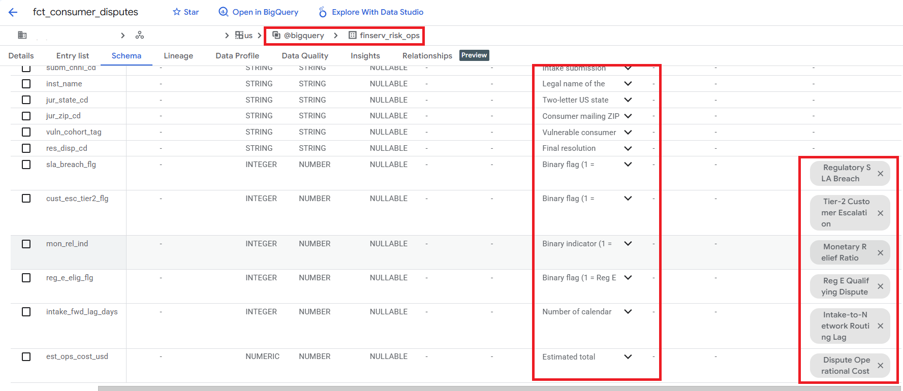
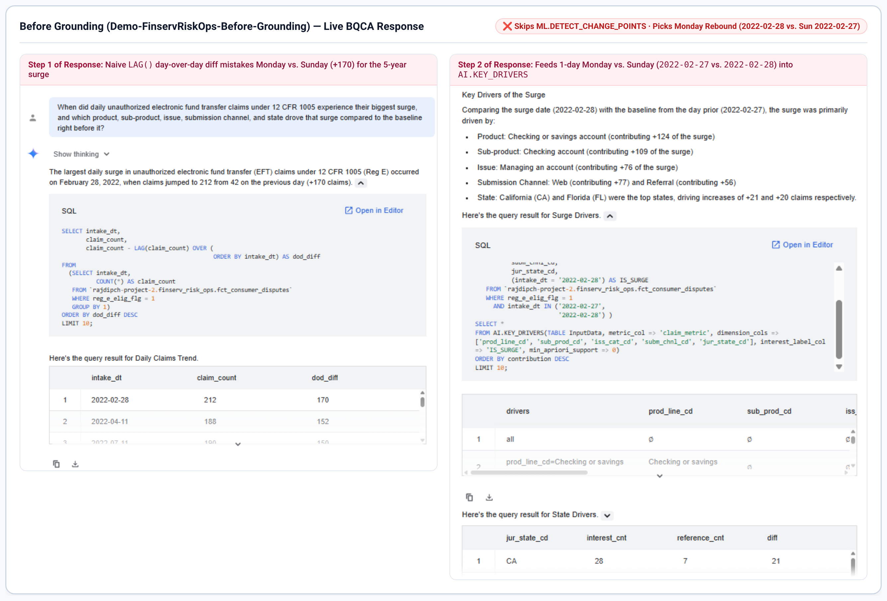
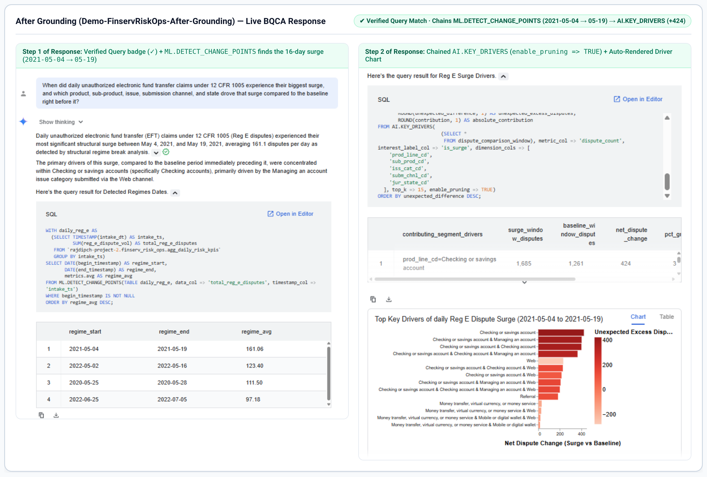
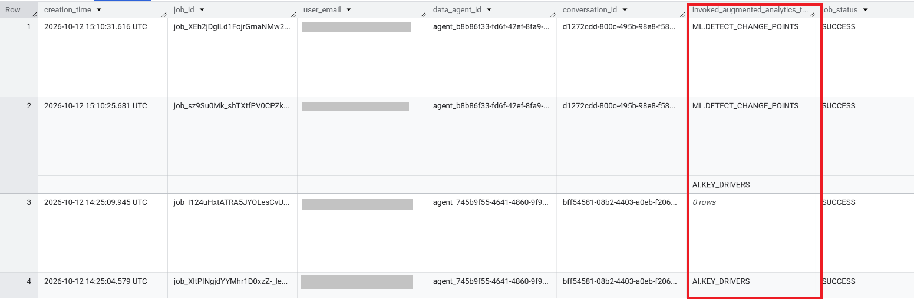

# Knowledge Catalog & BQCA Setup Guide and Copy-Paste Assets

This guide provides both the **click-by-click Google Cloud Console setup instructions** and all **copy-paste configuration payloads** required to configure **Knowledge Catalog** (schema enrichment, Data Profile & Data Insights scans, and Business Glossary) and your **BigQuery Conversational Analytics (BQCA) Data Agent** (`FinServ_Payments_Risk_Agent`), as referenced in the [main deployment runbook (`README.md`)](https://github.com/Rajdipc/bq-agentic-analytics-finserv-tvfs/blob/main/README.md) and the SQL scripts under [`sql/`](https://github.com/Rajdipc/bq-agentic-analytics-finserv-tvfs/tree/main/sql).

---

## 0. Prerequisites: APIs & IAM Roles

Before configuring Knowledge Catalog or BigQuery Conversational Analytics in the Console, ensure the following APIs and IAM permissions are enabled in your Google Cloud project.

### 0.1 Enable Required APIs
In the Google Cloud Console, navigate to **APIs & Services → Library** and enable each of the following (or run this command in Cloud Shell):

```bash
gcloud services enable \
  bigquery.googleapis.com \
  dataplex.googleapis.com \
  datacatalog.googleapis.com \
  geminidataanalytics.googleapis.com \
  cloudaicompanion.googleapis.com
```

### 0.2 Verify Required IAM Roles
In **IAM & Admin → IAM**, confirm your user principal has:

| Component | Required IAM Roles | What It Unlocks |
| :--- | :--- | :--- |
| **BigQuery Studio & TVFs** | `roles/bigquery.dataEditor` + `roles/bigquery.jobUser` | Creating `finserv_risk_ops`, running [`sql/01`](https://github.com/Rajdipc/bq-agentic-analytics-finserv-tvfs/blob/main/sql/01_setup_finserv_risk_mart.sql)–[`sql/06`](https://github.com/Rajdipc/bq-agentic-analytics-finserv-tvfs/blob/main/sql/06_audit_bqca_agent_jobs.sql), and updating column descriptions |
| **Knowledge Catalog** | `roles/dataplex.catalogEditor` + `roles/dataplex.dataScanAdmin` | Creating the Business Glossary (`FinServ_Risk_Glossary`), linking terms to columns, and triggering Data Profile / Data Insights scans |
| **BigQuery Conversational Analytics** | `roles/geminidataanalytics.dataAgentAdmin` + `roles/cloudaicompanion.user` | Creating, configuring, publishing, and chatting with `FinServ_Payments_Risk_Agent` |

---

## 1. Knowledge Catalog Business Glossary Terms (`FinServ_Risk_Glossary`)

Follow the three stages below to enrich your BigQuery tables, generate automated Data Profile and Data Insights scans, and bind authoritative banking definitions in **Knowledge Catalog**.

### 1.1 Stage 1 — Enrich Physical Table & Column Descriptions via SQL ([`sql/05_enrich_metadata_for_knowledge_catalog.sql`](https://github.com/Rajdipc/bq-agentic-analytics-finserv-tvfs/blob/main/sql/05_enrich_metadata_for_knowledge_catalog.sql))

> **Tip:** If you want to capture the **"Before Grounding"** failure mode first, run **Phase A** in [Section 4](#phase-a-the-before-grounding-test-direct-chat-on-raw-cryptic-table) *before* executing [`sql/05_enrich_metadata_for_knowledge_catalog.sql`](https://github.com/Rajdipc/bq-agentic-analytics-finserv-tvfs/blob/main/sql/05_enrich_metadata_for_knowledge_catalog.sql).

1. In the Google Cloud Console, navigate to **BigQuery → Studio**.
2. Click **+** (**Create SQL query**), paste the entire contents of [`sql/05_enrich_metadata_for_knowledge_catalog.sql`](https://github.com/Rajdipc/bq-agentic-analytics-finserv-tvfs/blob/main/sql/05_enrich_metadata_for_knowledge_catalog.sql), and click **Run**.
3. In the left **Explorer** pane, expand `finserv_risk_ops` and open **`fct_consumer_disputes` → Schema** (click the refresh icon if already open). Confirm that all **19 columns** now display regulatory and operational descriptions (`12 CFR 1005` scope on `reg_e_elig_flg`, proxy rules on `cust_esc_tier2_flg`, and the cost formula on `est_ops_cost_usd`).
4. Open **`agg_daily_risk_kpis` → Schema** and confirm that all **10 columns** also carry descriptions (**29 enriched columns in total**).

### 1.2 Stage 2 — Run Data Profile & Data Insights Scans in BigQuery Studio

1. In **BigQuery → Studio**, open `finserv_risk_ops.fct_consumer_disputes`.
2. **Generate Data Profile Scan:**
   * Click the **Data profile** tab at the top of the table details pane.
   * Click **Generate data profile** (or **Create data profile scan**).
   * In the scan configuration panel:
     * **Scope:** Select **Entire data** (the table is ~250 MB, so a full scan completes in under 60 seconds).
     * **Schedule:** Select **On-demand**.
   * Click **Create** (and **Run now** if prompted). When the scan finishes, the tab displays null rates, cardinality, quantiles, and top values for columns like `prod_line_cd`, `sub_prod_cd`, `iss_cat_cd`, and `subm_chnl_cd`.
3. **Generate Automated Data Insights:**
   * Click the **Insights** tab on `finserv_risk_ops.fct_consumer_disputes`.
   * Click **Generate insights**.
   * Wait ~1–2 minutes while Knowledge Catalog combines your newly populated column descriptions with the data profile statistics to generate grounded SQL patterns and distribution summaries.
4. **Repeat on the Daily KPI Rollup Table:**
   * Open `finserv_risk_ops.agg_daily_risk_kpis` in BigQuery Studio and run **Data profile → Generate data profile** and **Insights → Generate insights**.

### 1.3 Stage 3 — Create `FinServ_Risk_Glossary` and Link Terms to Physical Columns

> **Operational Learning from Live Testing:** Creating the `FinServ_Risk_Glossary` container in the Cloud Console is straightforward, but manually creating 6 terms and linking 13 physical BigQuery columns across two tables through the Console UI can be tedious—or unavailable depending on your Console view. We provide **both** a 1-command Python script ([`scripts/link_knowledge_catalog_glossary.py`](https://github.com/Rajdipc/bq-agentic-analytics-finserv-tvfs/blob/main/scripts/link_knowledge_catalog_glossary.py), using only Python stdlib + `gcloud` auth) that creates all 6 terms and binds all 13 column-level `entryLinks` (`entryLinkTypes/definition`) automatically, **and** the manual Console steps below.

#### Option A (Recommended — 10 Seconds via Cloud Shell or Terminal)
Whether you have already created an empty glossary named `FinServ_Risk_Glossary` in the Console (`Location = US`) or want the script to create it for you, run:

```bash
python3 scripts/link_knowledge_catalog_glossary.py
```

What [`scripts/link_knowledge_catalog_glossary.py`](https://github.com/Rajdipc/bq-agentic-analytics-finserv-tvfs/blob/main/scripts/link_knowledge_catalog_glossary.py) handles under the hood (and three Dataplex Universal Catalog API gotchas it solves):
1. **Console Glossary UUID Discovery:** When you create a glossary named `FinServ_Risk_Glossary` in the Cloud Console UI, Dataplex often assigns a generated UUID resource ID (e.g., `projects/<project>/locations/us/glossaries/jklhijkll-...`) rather than `finserv-risk-glossary`. The script lists `locations/us/glossaries` and matches `displayName == "FinServ_Risk_Glossary"` automatically.
2. **Mandatory `parent` Field in Term Creation:** `POST /v1/{glossary_name}/terms?termId={term_id}` requires `"parent": "{glossary_name}"` inside the JSON request body (omitting it raises `HTTP 400: Term parent must be specified`).
3. **Numeric `project_number` in `@dataplex` Entry IDs:** Column-to-glossary bindings are stored as Dataplex `EntryLink` resources (`projects/655216118709/locations/global/entryLinkTypes/definition`) in `projects/<project_id>/locations/us/entryGroups/@bigquery/entryLinks`, linking `path: "Schema.<column_name>"` on the `@bigquery` table entry to the `@dataplex` glossary term entry. Dataplex requires the target `@dataplex` entry ID to use the **numeric `project_number`** (`entries/projects/<project_number>/locations/us/glossaries/<glossary_id>/terms/<term_id>`), otherwise it rejects the link with `GLOSSARY_TERM_ENTRY_ID_CONTAINS_PROJECT_ID_ERROR`.

#### Option B (Manual Setup in the Google Cloud Console)
1. **Create the Business Glossary:**
   * In the Google Cloud Console navigation menu (**☰**), navigate to **Knowledge Catalog → Glossaries** (or under **BigQuery → Governance → Glossaries** / **Dataplex → Glossaries**, depending on your Console layout).
   * Click **+ Create business glossary** (or **+ Create glossary**):
     * **Display name:** `FinServ_Risk_Glossary`
     * **Location:** `US (multi-region)`
     * **Description:** `Authoritative Consumer Banking, Payments Operations, and Regulation E (12 CFR 1005) dispute glossary for BigQuery Conversational Analytics.`
   * Click **Create**.
2. **Add the 6 Business Glossary Terms & Link Columns:**
   * Open **`FinServ_Risk_Glossary`** and click **+ Create term** (or **+ Add term**) for each of the 6 terms in the table below, then bind each term to its mapped columns on `fct_consumer_disputes` (6 columns) and `agg_daily_risk_kpis` (7 columns) in **Knowledge Catalog → Search → Schema** (or run `python3 scripts/link_knowledge_catalog_glossary.py` to link all 13 columns automatically).

| Glossary Term (`term_id`) | Synonyms (comma-separated) | Authoritative Business Definition (Copy-Paste) | Linked BigQuery Columns |
| :--- | :--- | :--- | :--- |
| **Reg E Qualifying Dispute** (`reg-e-qualifying-dispute`) | `Reg E dispute`, `Regulation E claim`, `electronic fund transfer dispute`, `unauthorized EFT` | A consumer dispute on an account or service covered by the Electronic Fund Transfer Act (Regulation E, 12 CFR 1005): checking/savings and other deposit services (excluding CDs), Reg E prepaid accounts (general-purpose, government benefit, payroll, student prepaid), mobile/digital wallets, and domestic or international money transfers. Credit cards are excluded (Regulation Z), as are gift cards, virtual currency, money orders, and check cashing. Identified in `fct_consumer_disputes` where `reg_e_elig_flg = 1`, and aggregated daily in `agg_daily_risk_kpis.reg_e_dispute_vol`. | `fct_consumer_disputes.reg_e_elig_flg`, `agg_daily_risk_kpis.reg_e_dispute_vol` |
| **Tier-2 Customer Escalation** (`tier-2-customer-escalation`) | `Tier-2 escalation`, `supervisory review`, `escalated dispute`, `specialist review` | A proxy for disputes that needed specialist or supervisory review beyond Tier-1 intake: the institution breached the timely-response SLA, the response was marked untimely, or the issue is a fraud / scam / unauthorized-transaction claim. (The CFPB `consumer_disputed` field is not used because it has not been published since April 2017.) Identified where `cust_esc_tier2_flg = 1` and tracked as a daily percentage in `agg_daily_risk_kpis.tier2_escalation_rate_pct`. | `fct_consumer_disputes.cust_esc_tier2_flg`, `agg_daily_risk_kpis.tier2_escalation_rate_pct` |
| **Monetary Relief Ratio** (`monetary-relief-ratio`) | `monetary relief rate`, `cash redress rate`, `upheld with financial relief`, `reimbursement rate` | The percentage of consumer disputes closed with direct monetary reimbursement or fee reversal (`res_disp_cd = 'Closed with monetary relief'`). Tracked at the case level via `mon_rel_ind = 1` and as a daily percentage in `agg_daily_risk_kpis.monetary_relief_rate_pct`. | `fct_consumer_disputes.mon_rel_ind`, `agg_daily_risk_kpis.monetary_relief_rate_pct` |
| **Intake-to-Network Routing Lag** (`intake-to-network-routing-lag`) | `routing lag`, `forwarding lag`, `intake latency`, `queue routing delay` | The number of calendar days elapsed between initial dispute intake (`intake_dt`) and forwarding to the bank's operational resolution queue (`network_fwd_dt`). Tracked at the case level in `intake_fwd_lag_days` and averaged daily in `agg_daily_risk_kpis.avg_intake_fwd_lag_days`. | `fct_consumer_disputes.intake_fwd_lag_days`, `agg_daily_risk_kpis.avg_intake_fwd_lag_days` |
| **Regulatory SLA Breach** (`regulatory-sla-breach`) | `SLA breach`, `untimely response`, `late compliance response` | Failure to provide a formal resolution within the mandated regulatory response window (`timely_response = FALSE`). Identified where `sla_breach_flg = 1` and tracked as a daily percentage in `agg_daily_risk_kpis.sla_breach_rate_pct`. | `fct_consumer_disputes.sla_breach_flg`, `agg_daily_risk_kpis.sla_breach_rate_pct` |
| **Dispute Operational Cost** (`dispute-operational-cost`) | `handling cost`, `ops cost`, `dispute servicing cost`, `cost per dispute` | Total estimated operational servicing and settlement processing cost in USD for handling consumer disputes, combining base intake cost ($45), Reg E compliance surcharge ($35), routing lag penalty ($8.50/day), Tier-2 review ($120), and monetary relief processing ($165). | `fct_consumer_disputes.est_ops_cost_usd`, `agg_daily_risk_kpis.total_ops_cost_usd`, `agg_daily_risk_kpis.avg_ops_cost_per_dispute_usd` |



---

## 2. BQCA Data Agent Configuration (`FinServ_Payments_Risk_Agent`)

Follow these steps in **BigQuery Studio** to create and configure the grounded Data Agent.

### 2.0 Click-by-Click Agent Creation in BigQuery Studio
1. In the Google Cloud Console, open **BigQuery → Studio**.
2. In the left navigation bar, click **Agents** (or **Conversational Analytics**) and click **+ Create agent** (or **+ New data agent**).
3. **Configure Agent Identity:**
   * **Agent Name:** Copy-paste `FinServ_Payments_Risk_Agent` from **Section 2.1** below.
   * **Location:** Select **`us` (multi-region US)** so it matches the `finserv_risk_ops` dataset location.
   * **Description:** Copy-paste the description block from **Section 2.1** below.
4. **Attach Knowledge Sources (Tables):**
   * Under **Knowledge sources** (or **Data sources / Tables**), click **+ Add data source** (or **Select tables**).
   * Expand your project and dataset **`finserv_risk_ops`**, check **both** tables below, and click **Add / Select**:
     * `finserv_risk_ops.fct_consumer_disputes` *(granular case-level fact table used for `AI.KEY_DRIVERS`)*
     * `finserv_risk_ops.agg_daily_risk_kpis` *(daily KPI rollup table used for `ML.TREND`, `ML.SEASONALITY`, `ML.CORRELATION`, `ML.DETECT_CHANGE_POINTS`, and `AI.CAUSAL_EFFECT`)*
5. **Add System Instructions:**
   * In the **Instructions** (or **Agent instructions / Context**) box, copy-paste the entire 3-part block from **Section 2.2** below.
6. **Add Verified Queries:**
   * Scroll to the **Verified queries** (or **Golden queries / Example queries**) section, click **+ Add verified query**, and add each of the 3 Verified Queries from [**Section 3**](#3-verified-queries-copy-paste-into-the-verified-queries-section).
7. **Save and Publish:**
   * Click **Save** / **Publish** at the top right of the Agent configuration pane.

### 2.1 Agent Name & Description
* **Agent Name:** `FinServ_Payments_Risk_Agent`
* **Agent Description:**
  ```text
  Enterprise Risk & Compliance Data Agent for Consumer Banking and Payments Operations. Answers executive and analyst questions about Regulation E (Reg E) disputes, Tier-2 escalations, routing lag, monetary relief rates, and operational handling costs using BigQuery Augmented Analytics TVFs (ML.TREND, ML.SEASONALITY, ML.CORRELATION, ML.DETECT_CHANGE_POINTS, AI.KEY_DRIVERS, and AI.CAUSAL_EFFECT).
  ```

### 2.2 Agent Instructions (Copy-Paste into the "Instructions" Box)
```text
You are the Consumer Banking & Payments Risk Operations Data Agent. Follow these rules when interpreting questions and generating BigQuery SQL:

1. Knowledge Source Selection:
   - Use `finserv_risk_ops.agg_daily_risk_kpis` for daily time-series analyses (`ML.TREND`, `ML.SEASONALITY`, `ML.DETECT_CHANGE_POINTS`, `AI.CAUSAL_EFFECT`) and metric correlations (`ML.CORRELATION`).
   - Use `finserv_risk_ops.fct_consumer_disputes` for multi-dimensional root-cause attribution (`AI.KEY_DRIVERS`) across granular dimensions (`prod_line_cd`, `sub_prod_cd`, `iss_cat_cd`, `subm_chnl_cd`, `jur_state_cd`, `vuln_cohort_tag`).

2. Default Timeline & Metric Mappings:
   - Always use `intake_dt` as the primary date/timestamp column for time-series questions.
   - When asked about "Reg E disputes" or "electronic payment disputes", use `reg_e_dispute_vol` in `agg_daily_risk_kpis` or filter `reg_e_elig_flg = 1` in `fct_consumer_disputes`.
   - When asked about "Tier-2 escalations", use `tier2_escalation_rate_pct` (in `agg_daily_risk_kpis`) or `cust_esc_tier2_flg` (in `fct_consumer_disputes`).
   - When asked about "routing lag" or "forwarding delay", use `avg_intake_fwd_lag_days` or `intake_fwd_lag_days`.
   - When asked about "operational cost" or "handling cost", use `total_ops_cost_usd` or `est_ops_cost_usd`.

3. Augmented Analytics TVF Selection Rules:
   - For long-term trajectory or secular growth questions, invoke `ML.TREND`.
   - For recurring weekly, monthly, or yearly cyclical pattern questions, invoke `ML.SEASONALITY`.
   - For metric relationship strength or correlation matrix questions, invoke `ML.CORRELATION`.
   - For structural shifts, regime breaks, or baseline changes over time, invoke `ML.DETECT_CHANGE_POINTS`.
   - For root-cause attribution ("what drove the surge/change between two periods"), invoke `AI.KEY_DRIVERS` with `enable_pruning => TRUE`.
   - For quantifying counterfactual impact or intervention ROI after a specific date, invoke `AI.CAUSAL_EFFECT`.
```

---

## 3. Verified Queries (Copy-Paste into the "Verified Queries" Section)

In the **`FinServ_Payments_Risk_Agent`** builder, click **+ Add verified query** for each of the three queries below, paste the **Question** into the natural-language prompt field and the **SQL Query** into the query box, and click **Save**.

### Verified Query 1: Chained Structural Change Point & Key Drivers Attribution (from [`sql/03_act2_change_points_and_key_drivers_chain.sql`](https://github.com/Rajdipc/bq-agentic-analytics-finserv-tvfs/blob/main/sql/03_act2_change_points_and_key_drivers_chain.sql))
* **Question:**
  ```text
  Detect when the biggest structural shift occurred in daily Reg E disputes, and identify the top key drivers across product line, sub-product, issue category, submission channel, and state.
  ```
* **SQL Query:**
  ```sql
  WITH daily_reg_e AS (
    SELECT
      TIMESTAMP(intake_dt) AS intake_ts,
      SUM(reg_e_dispute_vol) AS total_reg_e_disputes
    FROM finserv_risk_ops.agg_daily_risk_kpis
    GROUP BY intake_ts
  ),
  detected_regimes AS (
    SELECT
      DATE(begin_timestamp) AS regime_start,
      DATE(end_timestamp) AS regime_end,
      metrics.avg AS regime_avg
    FROM ML.DETECT_CHANGE_POINTS(
      TABLE daily_reg_e,
      data_col => 'total_reg_e_disputes',
      timestamp_col => 'intake_ts'
    )
    WHERE begin_timestamp IS NOT NULL
  ),
  primary_surge_regime AS (
    SELECT
      regime_start,
      regime_end,
      DATE_DIFF(regime_end, regime_start, DAY) + 1 AS regime_days
    FROM detected_regimes
    ORDER BY regime_avg DESC
    LIMIT 1
  ),
  dispute_comparison_window AS (
    SELECT
      f.prod_line_cd,
      f.sub_prod_cd,
      f.iss_cat_cd,
      f.subm_chnl_cd,
      f.jur_state_cd,
      1 AS dispute_count,
      f.intake_dt >= r.regime_start AS is_surge
    FROM finserv_risk_ops.fct_consumer_disputes AS f
    CROSS JOIN primary_surge_regime AS r
    WHERE f.reg_e_elig_flg = 1
      AND f.intake_dt BETWEEN DATE_SUB(r.regime_start, INTERVAL r.regime_days DAY)
                          AND r.regime_end
  )
  SELECT
    drivers AS contributing_segment_drivers,
    metric_interest AS surge_window_disputes,
    metric_reference AS baseline_window_disputes,
    difference AS net_dispute_change,
    ROUND(relative_difference * 100, 1) AS pct_growth,
    ROUND(unexpected_difference, 1) AS unexpected_excess_disputes,
    ROUND(contribution, 1) AS absolute_contribution
  FROM AI.KEY_DRIVERS(
    (SELECT * FROM dispute_comparison_window),
    metric_col => 'dispute_count',
    interest_label_col => 'is_surge',
    dimension_cols => [
      'prod_line_cd',
      'sub_prod_cd',
      'iss_cat_cd',
      'subm_chnl_cd',
      'jur_state_cd'
    ],
    top_k => 15,
    enable_pruning => TRUE
  )
  ORDER BY unexpected_difference DESC;
  ```

### Verified Query 2: Operational Cost Correlation Matrix by Product Line (from [`sql/02_act1_baseline_trend_seasonality_correlation.sql`](https://github.com/Rajdipc/bq-agentic-analytics-finserv-tvfs/blob/main/sql/02_act1_baseline_trend_seasonality_correlation.sql))
* **Question:**
  ```text
  Which operational risk metrics have the strongest correlation with total dispute operational cost across banking product lines?
  ```
* **SQL Query:**
  ```sql
  SELECT
    CASE
      WHEN prod_line_cd IS NULL
        AND NOT EXISTS (SELECT 1 FROM UNNEST(segment) s WHERE s.dimension_col = 'prod_line_cd')
        THEN 'ALL PRODUCT LINES (Global Aggregate)'
      WHEN prod_line_cd IS NULL
        THEN 'UNSPECIFIED PRODUCT'
      ELSE prod_line_cd
    END AS product_line_scope,
    target_col,
    corr_col AS correlated_operational_metric,
    ROUND(correlation, 4) AS pearson_correlation,
    segment_size AS days_observed,
    ROUND(segment_proportion * 100, 2) AS pct_of_total_observations
  FROM ML.CORRELATION(
    TABLE finserv_risk_ops.agg_daily_risk_kpis,
    target_col => 'total_ops_cost_usd',
    target_correlation_cols => [
      'reg_e_dispute_vol',
      'avg_intake_fwd_lag_days',
      'tier2_escalation_rate_pct',
      'monetary_relief_rate_pct',
      'sla_breach_rate_pct'
    ],
    dimension_cols => ['prod_line_cd'],
    method => 'PEARSON'
  )
  WHERE segment_size >= 100
    AND NOT IS_NAN(correlation)
  ORDER BY ARRAY_LENGTH(segment) ASC, ABS(correlation) DESC;
  ```

### Verified Query 3: Counterfactual Causal Effect Analysis (from [`sql/04_act3_intervention_causal_effect.sql`](https://github.com/Rajdipc/bq-agentic-analytics-finserv-tvfs/blob/main/sql/04_act3_intervention_causal_effect.sql))
* **Question:**
  ```text
  Quantify the causal effect on daily Reg E dispute volume after 2020-07-01 between 2020-01-01 and 2020-10-01.
  ```
* **SQL Query:**
  ```sql
  WITH daily_reg_e_window AS (
    SELECT
      TIMESTAMP(intake_dt) AS intake_ts,
      SUM(reg_e_dispute_vol) AS total_reg_e_disputes
    FROM finserv_risk_ops.agg_daily_risk_kpis
    WHERE intake_dt BETWEEN '2020-01-01' AND '2020-10-01'
    GROUP BY intake_ts
  )
  SELECT
    ROUND(absolute_effect, 0) AS cumulative_incremental_disputes,
    ROUND(relative_effect * 100, 2) AS relative_effect_pct,
    ROUND(prob_causal_effect * 100, 2) AS causal_confidence_pct,
    ROUND(p_value, 6) AS p_value,
    status
  FROM AI.CAUSAL_EFFECT(
    (SELECT * FROM daily_reg_e_window),
    data_col => 'total_reg_e_disputes',
    timestamp_col => 'intake_ts',
    intervention_timestamp => '2020-07-01 00:00:00',
    confidence_level => 0.95,
    output_time_series => FALSE
  );
  ```
* **Important Compiler Note on `AI.CAUSAL_EFFECT`:**
  * BigQuery requires `intervention_timestamp` in `AI.CAUSAL_EFFECT` to be a compile-time `TIMESTAMP` literal (e.g., `'2020-07-01 00:00:00'`), rather than a runtime `@parameter` expression. Storing this Verified Query with a literal timestamp allows the BQCA Data Agent to use it as a few-shot SQL template and substitute the user's requested date literal at SQL-generation time.

---

## 4. "Before vs. After Grounding" Conversational Prompt Script & Live Findings

### Key Engineering Learnings from Live BQCA Testing
Before running the A/B comparison below, keep three architectural behaviors of BigQuery Conversational Analytics (BQCA) in mind:
1. **Built-in `ca-skill: bigquery-ai-ml-ca-rules` System Skill:** Every BQCA job carries the system label `ca-skill: bigquery-ai-ml-ca-rules`. That means BQCA **already knows the SQL syntax for `AI.KEY_DRIVERS` and the `ML.*` TVFs out of the box**. An ungrounded agent does not fail because it lacks TVF syntax; it fails on **table routing, statistical methodology (skipping `ML.DETECT_CHANGE_POINTS` for naive `LAG()`), and missing parameter discipline (`enable_pruning => TRUE`)**.
2. **Substring Matching on Cryptic Identifiers:** Even when column descriptions are blank (`-`), an LLM can still guess that prompt words like *"Reg E"* or *"Tier-2"* map to `reg_e_elig_flg` and `cust_esc_tier2_flg` by matching substrings of the column identifiers (and running 3 exploratory `MIN/MAX(intake_dt)` + `EXTRACT(YEAR FROM intake_dt)` queries first). To genuinely test semantic and methodological grounding, phrase prompts in business/regulatory terms (*"unauthorized electronic fund transfer claims under 12 CFR 1005"*) and require multi-step regime-to-driver attribution.
3. **Agent & Thread State Isolation:** Editing an existing Data Agent's instructions/tables in-place or re-prompting inside an existing thread reuses cached conversation context. Always create two separate agents (`Demo-FinservRiskOps-Before-Grounding` and `Demo-FinservRiskOps-After-Grounding`) and start a fresh thread in each.

---

### Phase A: The "Before Grounding" Test (`Demo-FinservRiskOps-Before-Grounding`)
Run this test **before** executing [`sql/05_enrich_metadata_for_knowledge_catalog.sql`](https://github.com/Rajdipc/bq-agentic-analytics-finserv-tvfs/blob/main/sql/05_enrich_metadata_for_knowledge_catalog.sql) or attaching the Knowledge Catalog Glossary:

1. In **BigQuery → Studio**, click **Agents** (or **Conversational Analytics**) in the left navigation.
2. Create an ungrounded test agent (`Demo-FinservRiskOps-Before-Grounding`, e.g., `agent_745b9f55-4641-4860-9f9f-7ff562a46882`) with **empty** Agent Instructions and **zero** Verified Queries, attaching **only** `<your-project>.finserv_risk_ops.fct_consumer_disputes` (with its blank column descriptions).
3. Submit the following prompt:

> **Prompt:**
> *"When did daily unauthorized electronic fund transfer claims under 12 CFR 1005 experience their biggest surge, and which product, sub-product, issue, submission channel, and state drove that surge compared to the baseline right before it?"*

4. Expand the generated **SQL** blocks under the agent's reply (`images/05_bqca_before_grounding.png`). In our live execution (`conversation_id = bff54581-08b2-4403-a0eb-f2065b390675`), the ungrounded agent generated **4 separate SQL queries**:
   * **SQL #1 (Skips `ML.DETECT_CHANGE_POINTS` for Naive `LAG()`):** Without `agg_daily_risk_kpis` or Verified Query 1, it wrote `claim_count - LAG(claim_count) OVER (ORDER BY intake_dt) AS dod_diff`. Because consumer dispute intake drops every Sunday and rebounds every Monday, `LAG()` mistook a routine **Monday-vs.-Sunday rebound (`2022-02-28` at 212 claims vs. Sunday `2022-02-27` at 42 claims = `+170`)** for the largest surge in five years! (Its top 3 rows—`2022-02-28`, `2022-04-11`, `2022-07-11`—were all Mondays.)
   * **SQL #2 (Ad-hoc Window Check):** Queried daily counts between `'2022-02-20'` and `'2022-03-05'`.
   * **SQL #3 (Unpruned `AI.KEY_DRIVERS` on a 2-Day Window):** Invoked `AI.KEY_DRIVERS` on `WHERE intake_dt IN ('2022-02-27', '2022-02-28')` with `(intake_dt = '2022-02-28') AS IS_SURGE`, `min_apriori_support => 0`, `ORDER BY contribution DESC LIMIT 10`, and **omitted `enable_pruning => TRUE`**. Because pruning was off and it sorted by raw `contribution`, Row 1 was the trivial `all` slice, and redundant parent/child slices crowded out every `jur_state_cd` row from the top 10.
   * **SQL #4 (Manual `GROUP BY jur_state_cd` Fallback):** Because no state appeared in its unpruned `LIMIT 10`, the agent had to run a 4th manual query (`COUNTIF(intake_dt = '2022-02-28') - COUNTIF(intake_dt = '2022-02-27') AS diff GROUP BY jur_state_cd`), reporting `CA` (`28` vs. `7` = `+21`) and `FL` (`+20`).



---

### Phase B: The "After Grounding" 3-Turn Executive Investigation (`Demo-FinservRiskOps-After-Grounding` / `FinServ_Payments_Risk_Agent`)
Once [`sql/05_enrich_metadata_for_knowledge_catalog.sql`](https://github.com/Rajdipc/bq-agentic-analytics-finserv-tvfs/blob/main/sql/05_enrich_metadata_for_knowledge_catalog.sql) and [`scripts/link_knowledge_catalog_glossary.py`](https://github.com/Rajdipc/bq-agentic-analytics-finserv-tvfs/blob/main/scripts/link_knowledge_catalog_glossary.py) are applied and your grounded agent (`Demo-FinservRiskOps-After-Grounding`, e.g., `agent_b8b86f33-fd6f-42ef-8fa9-6e6838ee7a05`, or `FinServ_Payments_Risk_Agent`) is saved with both tables, Instructions, and the 3 Verified Queries:

1. In **BigQuery → Studio → Agents**, select your grounded agent and click **Start conversation** (always start a fresh chat so cached pre-enrichment metadata is cleared).
2. Run the 3-turn executive investigation below, clicking **View generated SQL** after each response:

* **Turn 1 (Act 1 — Trend, Seasonality & Correlation):**
  > *"Analyze the long-term trend and yearly and weekly seasonality of our daily Reg E disputes. Then tell me which operational metrics have the strongest correlation with total dispute operational cost across banking product lines."*
  * **Expected SQL & Output:** Calls `ML.TREND`, `ML.SEASONALITY`, and `ML.CORRELATION` (`dimension_cols => ['prod_line_cd']`) on `finserv_risk_ops.agg_daily_risk_kpis`, reporting `reg_e_dispute_vol` correlations of `r = 0.9405` in money transfer and `r = 0.9141` in checking/savings.

* **Turn 2 (Act 2 — Structural Change Points & Key Drivers Attribution; Direct Counterpart to Phase A):**
  > *"When did daily unauthorized electronic fund transfer claims under 12 CFR 1005 experience their biggest surge, and which product, sub-product, issue, submission channel, and state drove that surge compared to the baseline right before it?"*
  * **Observed Live SQL & Output (`conversation_id = d1272cdd-800c-495b-98e8-f5825bc4b172`, see [`images/07_bqca_after_grounding_tvf.png`](https://github.com/Rajdipc/bq-agentic-analytics-finserv-tvfs/blob/main/images/07_bqca_after_grounding_tvf.png)):**
    * Displays the green **Verified Query badge (`✓`)** and executes **2 complementary SQL queries**:
      1. **Job 1 (`ML.DETECT_CHANGE_POINTS` → `AI.KEY_DRIVERS` from VQ-1):** Chains the detected 16-day surge window (`2021-05-04` to `2021-05-19`) against the equal-length 16-day preceding baseline (`2021-04-18` to `2021-05-03`) into `AI.KEY_DRIVERS` (`top_k => 15, enable_pruning => TRUE`), attributing the surge to `Checking or savings account` (`1,685` vs. `1,261` = **`+424`**, `+33.6%`, `+425.4` unexpected excess) and `Checking account × Managing an account` (`+61.0%`) via `Web`, and auto-rendering the horizontal bar chart (`Top Key Drivers of daily Reg E Dispute Surge (2021-05-04 to 2021-05-19)`).
      2. **Job 2 (Standalone `ML.DETECT_CHANGE_POINTS` Regime Table):** Because VQ-1's outer `SELECT` returns the `AI.KEY_DRIVERS` rows while the prompt also asked *"When did daily ... claims experience their biggest surge"*, the agent automatically extracts the `ML.DETECT_CHANGE_POINTS` CTE (`ORDER BY regime_avg DESC`) as a second query to display the 4 detected regimes (`2021-05-04 → 2021-05-19` at **`161.06`/day**, `2022-05-02 → 2022-05-16` at `123.40`/day, `2020-05-25 → 2020-05-28` at `111.50`/day, and `2022-06-25 → 2022-07-05` at `97.18`/day).



* **Turn 3 (Act 3 — Counterfactual Causal Effect):**
  > *"Quantify the causal effect on daily Reg E dispute volume after 2020-07-01 between 2020-01-01 and 2020-10-01, and also break down the causal impact on daily operational cost by banking product line."*
  * **Expected SQL & Output:** Executes `AI.CAUSAL_EFFECT` on `finserv_risk_ops.agg_daily_risk_kpis`, reporting a portfolio cumulative effect of **`-1,573` (`-13.31%`)** with **`p = 0.594848`** (`40.52%` confidence — no statistically significant portfolio effect), and uses `id_cols => ['prod_line_cd']` to surface `Money transfer, virtual currency, or money service` (**`-$188,165.11`**, `-33.42%`, `90.93%` confidence, `p = 0.0907`).

3. **Audit All Agent-Generated TVF Jobs (`sql/06_audit_bqca_agent_jobs.sql`):**
   * Open a SQL editor tab in **BigQuery → Studio**, paste [`sql/06_audit_bqca_agent_jobs.sql`](https://github.com/Rajdipc/bq-agentic-analytics-finserv-tvfs/blob/main/sql/06_audit_bqca_agent_jobs.sql), and click **Run** to inspect the `ca-bq-job = 'true'` entries in `` `region-us`.INFORMATION_SCHEMA.JOBS `` (`data_agent_id`, `conversation_id`, `invoked_augmented_analytics_tvfs`, `mb_billed`, `execution_ms`, and `generated_sql`).
   * As shown in [`images/08_information_schema_audit.png`](https://github.com/Rajdipc/bq-agentic-analytics-finserv-tvfs/blob/main/images/08_information_schema_audit.png), Rows 1–2 capture `Demo-FinservRiskOps-After-Grounding` (`agent_b8b86f33...`) invoking `["ML.DETECT_CHANGE_POINTS"]` and `["ML.DETECT_CHANGE_POINTS", "AI.KEY_DRIVERS"]`, while Rows 3–4 capture `Demo-FinservRiskOps-Before-Grounding` (`agent_745b9f55...`) falling back to `0 rows` (manual `GROUP BY jur_state_cd`) and unpruned `["AI.KEY_DRIVERS"]`.



